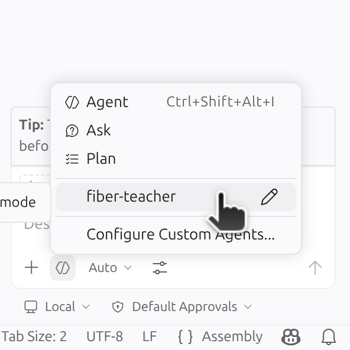

🌐 [Català](README.md) | **Español**

# Reto de vectorización RISC-V: Multiplicación de matrices (gemm)

## 👋 Introducción

Bienvenido a esta práctica de laboratorio interactiva de la asignatura [Estructura de Computadores (EC)](https://www.fib.upc.edu/es/grados/grado-en-ingenieria-informatica/plan-de-estudios/asignaturas/EC) de la Facultad de Informática de Barcelona (FIB) en la Universitat Politècnica de Catalunya (UPC). En esta sesión exploraremos cómo acelerar la multiplicación de dos matrices (en inglés: *general matrix-matrix multiplicacion* - `gemm`) utilizando la extensión vectorial RVV de RISC-V. Lo haremos con el apoyo de la inteligencia artificial agéntica (GitHub Copilot) y, más concretamente, del agente docente **fiber-teacher**, que actuará como tu tutor personal.

Esta actividad forma parte de un proyecto de innovación docente que busca potenciar tu autonomía, familiarizarte con herramientas de IA y prepararte para arquitecturas de computadores más avanzadas que estudiarás en otras asignaturas.

## 🎯 Objetivo de la práctica y resultados de aprendizaje

El objetivo es pasar de una implementación **escalar** (ejecución instrucción a instrucción de manera secuencial) a una implementación **vectorial** (ejecución paralela de varias instrucciones). Aprenderás a utilizar el concepto *vector length agnostic* (VLA), que permite que el mismo código se ejecute con diferentes anchuras del vector.

La multiplicación de matrices se puede interpretar como una aplicación sucesiva de productos escalares entre un primer vector que representa las filas de una matriz $\mathbf{A}$ y un segundo que contiene las columnas de una matriz $\mathbf{B}$:

$$
\mathbf{C} = \mathbf{A}\mathbf{B} \iff
c_{ij} = \sum_{k=0}^{n-1} a_{ik} b_{kj} =a_{i0} b_{0j} + a_{i1} b_{1j} + \ldots + a_{i,n-1} b_{n-1,j}.
$$

La siguiente imagen compara el recorrido secuencial de un vector (izquierda) frente al recorrido vectorial (derecha) de dos elementos a la vez, ciclo a ciclo. Fíjate en que el vectorial termina en la **mitad** de tiempo:


Tu objetivo es:

1. Analizar el código escalar de referencia y resolver las dudas relacionadas.
2. Identificar cuál de los tres bucles ($i, j, k$) es el candidato más *sencillo* para vectorizar.
3. Implementar una solución vectorial que aproveche la naturaleza **VLA (vector length agnostic)** de RISC-V para obtener un speedup significativo.

## 📋 Trabajo previo

Antes de continuar, realiza las siguientes tareas obligatorias que te permitirán familiarizarte con las instrucciones vectoriales de RISC‑V, la plataforma GitHub, la herramienta VS Code y Copilot Chat. La duración estimada es de 60 minutos.

### Introducción a RVV

Sigue el tutorial de Krste Asanovic y Roger Espasa. Los enlaces al material son:

* [Transparencias del tutorial RVV](https://riscv.org/wp-content/uploads/2024/12/15.20-15.55-18.05.06.VEXT-bcn-v1.pdf)
* [Tutorial de 35 minutos de YouTube sobre la ISA vectorial de RISC-V](https://www.youtube.com/watch?v=S4fxBZD79gc)

### Introducción a Git y GitHub (Education)

En primer lugar, crea una cuenta de [GitHub (Education)](https://github.com/education) con tu correo electrónico de la UPC (tendrás que verificar que eres estudiante). En segundo lugar, te recomiendo el tutorial sobre Git y GitHub. Los enlaces al material son:

* [Documentación oficial y guía rápida de GitHub Education](https://docs.github.com/en/education/quickstart)
* [Tutorial de Git y GitHub](https://github.com/estructura-de-computadors/vectoritzacio-riscv-introduction-to-git-and-github-github-starter-course)

### Instalación de software

1. Instala [Docker](https://www.docker.com) y [VS Code](https://code.visualstudio.com/) en tu ordenador (hay ciertas incompatibilidades con Podman y VSCodium, razón por la cual se desaconseja instalar estas alternativas de código abierto).
2. Abre VS Code, instala la extensión [GitHub Copilot Chat](https://marketplace.visualstudio.com/items?itemName=GitHub.copilot-chat) y configúrala con tu cuenta de GitHub.
3. Instala la extensión [Dev Containers](https://marketplace.visualstudio.com/items?itemName=ms-vscode-remote.remote-containers).
4. Instala la extensión [General Assembly Highlighter](https://marketplace.visualstudio.com/items?itemName=VicentBaeza.assembly-syntax).

## 📂 Estructura del repositorio

El repositorio contiene los siguientes ficheros clave:

* **`Makefile`**: Herramienta para automatizar la compilación, la ejecución y el testeo del código.
* **`matrix_mult.c`**: El programa principal (`main`) que se encarga de inicializar las matrices, llamar a las funciones de multiplicación de matrices y medir su tiempo de ejecución.
* **`gemm.c`**: Implementación de referencia en lenguaje C del algoritmo de la multiplicación de matrices.
* **`gemm_riscv_scalar.s`**: Código fuente en ensamblador RISC-V utilizando instrucciones escalares. Se trata de una segunda solución de referencia escrita en ensamblador.
* **`gemm_riscv_vector.s`**: Fichero donde debes desarrollar la solución vectorial utilizando la extensión RVV. Contiene una estructura básica con TODOs para guiarte.
* **`AGENTS.md`**: Fichero de configuración de la IA agéntica. Aquí se define el comportamiento del agente fiber-teacher.
* **`EVALUATION.md`**: Informe final que debes rellenar y entregar al final de la práctica, incluyendo el análisis de rendimiento y la reflexión sobre el uso que has hecho de la IA.

## 🛠️ Instrucciones de uso

### VS Code

1. Descarga el repositorio en tu ordenador (`git clone https://github.com/estructura-de-computadors/gemm.git`).
2. Abre el repositorio con VS Code (`File -> Open folder...`) y selecciona la opción: `Yes, I trust the authors`.
3. Fíjate en que la extensión Dev Containers te pedirá *reabrir* el repositorio dentro de un contenedor (docker): acepta la invitación.  Si no apareciera el mensaje, cierra VS Codegg y vuelve a abrirlo.
4. Espera varios minutos a que se descargue la imagen de Docker.  La primera vez puede tardar varios minutos, en función de la conectividad a Internet.

### Copilot Chat

<div style="text-align:center;">
  
</div>

1. Dentro de la ventana de chat, abajo del todo, reemplaza el agente por defecto `Agent` por el agente docente `fiber-teacher`.
2. Empieza una conversación saludando al agente y diciéndole que eres estudiante de Estructura de Computadores.
3. El agente se presentará y empezará a hacerte preguntas.
4. A continuación, puedes pedirle que te haga un repaso del algoritmo del producto escalar, analizando las implementaciones escalares en lenguaje C y en ensamblador de RISC-V.
5. Recuerda que el agente es completamente autónomo y no necesita intervención humana. Se aconseja pedir al agente que vaya paso a paso: hay **6** en esta práctica.
6. Si lo consideras necesario, pide al agente que vuelva a empezar o que explique los pasos con más detalle.
7. Asegúrate de confirmar la ejecución de comandos por parte del agente: `make`, `find`, `pdftotext` ...

### Compilación y ejecución

Las diferentes reglas se encuentran en el fichero `Makefile`. Para compilar uno de los binarios (implementación en lenguaje C) asociados a la multiplicación de matrices utiliza:

```bash
make matrix_mult_c
```

Para ejecutar el binario generado utiliza:

```bash
make run_matrix_mult_c
```

### Limpieza del directorio

Para eliminar los binarios utiliza:

```bash
make clean
```

## 🚀 Metodología de trabajo

1. **Preparación:** Antes de empezar, asegúrate de haber revisado el material previo sobre la ISA vectorial de RISC-V y el funcionamiento de la extensión RVV. Instala VS Code siguiendo las instrucciones descritas en este documento. Finalmente, recuerda añadir al repositorio el PDF de la especificación RVV 1.0 para que el agente pueda trabajar correctamente.
2. **Pon en marcha el cronómetro:** Empieza a medir el tiempo que dedicas a realizar la práctica para reportarlo más adelante.
3. **Configuración del agente:** Abre el fichero `AGENTS.md` para comprender cómo está definido el rol del agente `fiber-teacher`.
4. **Desarrollo iterativo:** Habla con el agente para entender cómo se debe implementar la vectorización de manera gradual. Puedes pedirle detalles específicos sobre cómo configurar la longitud del vector `VL` con la instrucción `vsetvli` y cómo realizar la reducción final de un registro vectorial a uno escalar.
5. **Validación:** Pide al agente que compare los resultados entre las versiones escalar y vectorial usando los comandos disponibles en el `Makefile`, los tiempos medidos, el speedup final obtenido y el teórico.
6. **Medibilidad**: Mide el budget consumido asociado a las interacciones con el agente (tokens, requests, etc.), los outputs del terminal y guarda la transcripción completa del chat con el agente. Recuerda adjuntar esta información como parte de la entrega.

## 📝 Entrega

Cuando termines la sesión, detén el cronómetro, completa los apartados del fichero `EVALUATION.md` y entrégalo junto con los siguientes ficheros:

1. **`prompt.md`**: Transcripción completa del chat con el agente.
2. **`terminal.md`**: Outputs del terminal generados por el agente.
3. **`budget.md`**: Budget consumido durante las interacciones (en tokens, premium requests, etc.).

Se valorará especialmente:

* La mejora de rendimiento alcanzada (speedup).
* La calidad y el pensamiento crítico demostrados en tus interacciones con el agente de IA.
* La calidad de tus respuestas a las preguntas generadas por el agente.
* La transparencia al identificar qué partes de esta metodología docente te han *realmente* ayudado a entender un problema tan complejo como es la vectorización de RISC-V en instrucciones de ensamblador.

## 📚 Material adicional

Para evitar las alucinaciones y mejorar la transparencia de las respuestas del agente, se recomienda añadir el documento de especificación:

* [Especificación de la versión 1.0 de la extensión RVV](https://github.com/riscvarchive/riscv-v-spec/releases/download/v1.0/riscv-v-spec-1.0.pdf)

## ⚖️ Ética y uso responsable

Este proyecto incluye un agente de IA para ayudarte a aprender. Úsalo como una herramienta para explorar ideas, entender conceptos y depurar tu trabajo, pero recuerda que algunas de las respuestas generadas pueden ser incompletas o incorrectas, a pesar de que la IA agéntica es capaz de autocorregirse. **Es importante que protejas tu privacidad** compartiendo solo la información necesaria para realizar la tarea. No reveles nunca tu nombre completo, dirección, número de teléfono, correo electrónico, identificador de estudiante, contraseñas, ficheros privados ni ninguna otra información personal sensible. Del mismo modo, no compartas información personal sobre compañeros, instructores o cualquier otra persona sin su consentimiento explícito. Como regla general, minimiza los datos que proporcionas.

Interactúa con el agente de manera respetuosa y responsable. No lo uses para generar contenido abusivo o acosador, pedir instrucciones perjudiciales o inseguras, o dar apoyo a actividades no éticas. Sigue las políticas de integridad académica de la universidad: el agente puede ayudarte a aprender, explicar conceptos o identificar errores, pero no se debe utilizar para completar trabajos evaluados u obtener una ventaja injusta, salvo que tu profesor lo haya permitido explícitamente. En caso de duda, trata la IA como un asistente de aprendizaje en lugar de una fuente autoritativa o un sustituto de tu propio trabajo.

## 🔒 Licencia

Este proyecto está licenciado bajo la Licencia Pública General GNU versión 3.0 o posterior (GPL-3.0-or-later). Consulta el fichero [LICENSE](LICENSE) para más detalles.

## 📇 Información de contacto

Dr. Pedro J. Martinez-Ferrer \
Departamento de Arquitectura de Computadores (DAC) \
Universitat Politècnica de Catalunya - BarcelonaTech (UPC) \
Campus Nord, Edif. D6, C. Jordi Girona 1-3, 08034 Barcelona, Spain \
pedro.martinez.ferrer [at] upc [dot] edu
